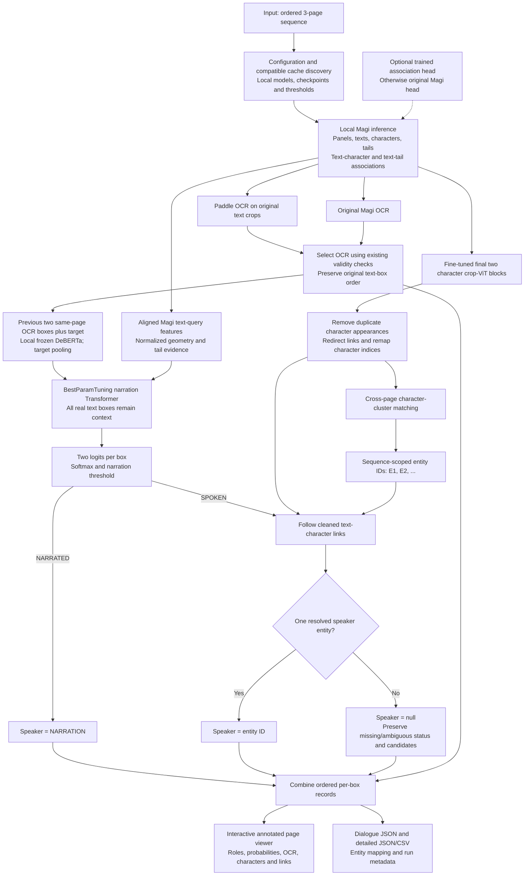

# Full project inference pipeline

Run `pipelineFULL_INFERENCE.ipynb` in **Godfather (Python 3.11 | Torch + Paddle GPU)**, from top to bottom. Each code cell has a Markdown description. The notebook does not train, read ground-truth labels, or download models.

## Flow



## Configure before running

Edit notebook cell **2**: `MAGI_ROOT`, `MODEL_PATH`, `SPLIT`, `SEQUENCE_ID`, character checkpoint/threshold, and the narration export directory. Sequence images are loaded from `TaskData/<split>/images/<sequence_id>/`; filenames must sort into reading order. Exactly three pages are required because narration was trained with three page embeddings and full three-page samples.

Narration can be swapped in the first settings cell. Defaults still use `NarrationImbalanceTraining/BestParamTuning`. Change `BEST_DIR` to select a different compatible export folder, or set the files independently:

```python
NARRATION_MODEL_PATH = BEST_DIR / 'model.py'
NARRATION_CHECKPOINT_PATH = BEST_DIR / 'best.pt'
NARRATION_CONFIG_PATH = NARRATION_ROOT / 'config.py'
NARRATION_MODEL_CLASS = 'BoxClassifier'
NARRATION_MODEL_KWARGS = {}  # Optional constructor overrides.
NARRATION_THRESHOLD_OVERRIDE = None  # Or an explicit validation-selected number.
THRESHOLD_FILE = NARRATION_CHECKPOINT_PATH.with_name('threshold.json')  # Or None.
```

Restart the kernel and run all cells after switching. Use the matching training config for encoder/preprocessing settings. Architecture dimensions come from checkpoint metadata; optional constructor overrides must match the weights, which load strictly. The checkpoint must contain `state_dict`, `visual_dim`, and `max_positions`. The selected class must accept the existing text/visual/geometry/tail/page/attention-mask batch dictionary and return `[batch, boxes, 2]` finite logits ordered SPOKEN, NARRATED. DINO crop-feature checkpoints require `pipelineFullInferenceDino.ipynb`. This notebook never invokes a training notebook or reads labels.

Selected file paths, SHA256 hashes, class and constructor overrides are recorded in the cache identity and run metadata. Changing them recomputes narration predictions and dependent records; compatible visual and semantic features remain reusable.

`NARRATION_THRESHOLD_OVERRIDE` takes precedence when set. Otherwise `NARRATION_THRESHOLD` reads `THRESHOLD_FILE` when present and defaults to 0.5 when it is absent or disabled. That optional file has the form `{"threshold": 0.5}`. Select a different threshold on validation data; inference does not tune it.

`ASSOCIATION_HEAD_PATH = None` retains the original Magi associations. Set a checkpoint path to use the trained Manga109 text-character head. That option changes the association-head weights before Magi prediction and uses a separate cache namespace; it does not alter narration query/tail features.

The existing two-block crop checkpoint and its validated entity threshold are kept together. If you change the character checkpoint, update the threshold and expected epoch from its validation experiment. Character embeddings use original RGB; Magi detections and narration query features use training-compatible grayscale RGB.

Paddle detector/recognizer paths point to the downloaded `~/.paddlex/official_models/` directories and are configurable. Magi/DeBERTa use local files; Magi's TrOCR processor must already exist in the local Hugging Face cache. Missing local assets produce an error rather than downloading replacements.

## Cache behavior

Original inference stage caches are discovered under `paddleOCR-Magi/cache_inference/<split>/<sequence_id>/`. Compatible Magi, character embeddings, OCR, cleanup, entity and text-entity caches are reused. A missing or incompatible stage is computed at that stage and saved. Explicit local Paddle model paths enter the OCR signature, so an older cache without that identity may be rebuilt once.

The new `narration_visual`, `narration_semantic`, `narration_predictions`, and `full_records` caches are independent. Visual extraction can also reuse matching training `cache/magi_pages/*.pt` entries. Selected OCR and DeBERTa files determine semantic cache reuse. Threshold/checkpoint changes invalidate predictions without forcing feature extraction.

Every cached text box must have a distinct query match above the training IoU threshold. Unmatched boxes stop execution rather than being discarded. Inputs exceeding the checkpoint's learned position capacity also stop with an explanation. This notebook does not invent positional embeddings or silently truncate context.

Use the `FORCE` dictionary to recompute an individual stage. Bump its `STAGE_VERSIONS` entry when changing an inherited stage algorithm. Character and narration model stages release GPU memory before the next heavy encoder.

## View and export

Cells **23–25** provide an interactive page dropdown, OCR source dropdown, and annotation toggles. Orange text boxes are narration; blue text boxes are spoken. Labels show narration probability and final speaker. `inspect_text(page_index, text_index)` shows a crop and its full OCR/prediction record. Direct `show_page(...)` calls work without widgets, and can save annotated PNGs.

Outputs are under the sequence cache's `full_pipeline/` directory:

- `dialogue_pages.json`: ordered lists of `{"speaker": "E1", "text": "..."}` records; narration uses `"NARRATION"`, unresolved/ambiguous speech uses `null`.
- `box_predictions.json` and `.csv`: every detected box with stable sequence/page/text IDs, geometry, raw logits, probabilities, role, selected OCR source, association candidates, final speaker and review flags.
- `entities.json`: cross-page character members, mapping and matching audit.
- `run_metadata.json`: input image hashes, model/checkpoint identities, architecture, thresholds, association-head selection and stage-cache identities.
- `annotations/`: optional PNGs when the example export loop is enabled.

`EXPORT_ESSENTIAL_ONLY = False` keeps every box in dialogue export by default. Set it to true to reproduce the old Magi essential-text export filter. Essential flags never enter the narration model and never remove boxes from its context or the detailed predictions. Text order stays fixed.

Entity IDs are scoped to the sequence, not canonical character names. The original association candidates remain in detailed records even when the final speaker is narration. These are inference outputs, not measured accuracy or calibrated probabilities.
