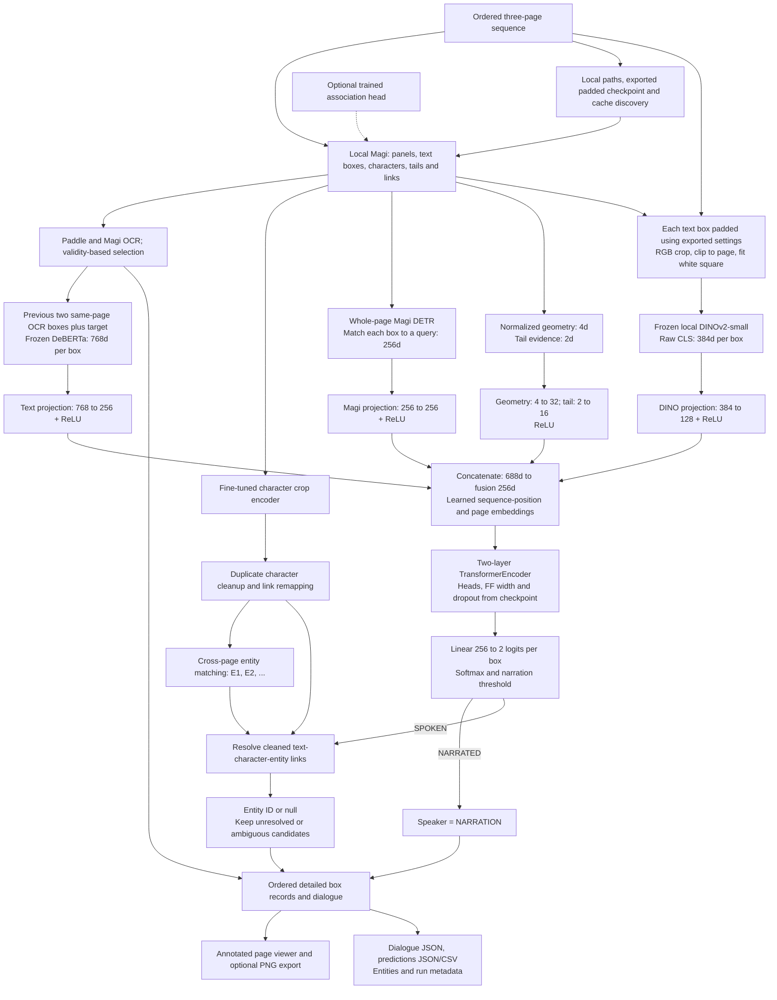

# Full project inference with padded DINO crops

Run `pipelineFullInferenceDino.ipynb` with a fresh **Godfather** kernel, top to bottom.
Each code cell has a description and comments. No training or model downloads are performed.

## Settings and model contract

Edit configuration cell 2 for sequence, paths, character settings and narration threshold.
Input pages are `TaskData/<split>/images/<sequence_id>/*.png`, sorted in reading order;
exactly three pages are required. No text boxes are removed from narration context.

The narration export is **NarrationImbalanceTrainingPaddedBox/BestParamTuning**:
`best.pt`, `model.py`, `preprocessing.json` and `crop_features.py` must stay together.
Architecture and crop width come from the checkpoint. Crop preprocessing comes from its
exported JSON and must equal the checkpoint feature contract. The helper hash and local
DINO model/processor file fingerprints are checked against training before feature creation.
The current export uses 20% of the original width/height on each side and a 224px white
square. These are read from the export, not hardcoded into inference.
The complete padded crop is resized with preserved aspect ratio; no center crop or L2
normalization is applied. Original RGB pages feed DINO; training-compatible grayscale RGB
feeds Magi. The separate fine-tuned character encoder still handles character identity.

Magi and DeBERTa use the padded experiment's config. DINO uses the export's local model
path (`C:\MODELS\dinov2-small` in the current export); Paddle uses local model directories.
All Hugging Face loads are local-only. Existing cached TrOCR assets must also be available.
Use `show_dino_crop(page_index=0, text_index=0)` to inspect the actual padded DINO input.

`NARRATION_THRESHOLD` reads optional `BestParamTuning/threshold.json`, otherwise defaults
to 0.5. Inference does not choose a threshold. Learned position capacity is checked;
too many boxes or failed Magi query alignment produce an error rather than dropping boxes.

## Caches, viewer and outputs

Compatible Magi, character, OCR, entity, semantic and Magi narration-feature caches are
reused under `paddleOCR-Magi/cache_inference/<split>/<sequence_id>/`.
Missing stages are computed where needed. DINO features use `narration_dino.json`, keyed
by page hashes, box geometry, exported crop settings, encoder identity and algorithm.
Prediction and final-record caches use separate `narration_dino_predictions.json` and
`full_records_dino.json` files, so they do not replace original-model predictions.
Changing the classifier or threshold invalidates predictions while preserving features.
Use `FORCE` to refresh a stage; heavy encoders release GPU memory between stages.

The original page dropdown, OCR-source selection, annotation toggles, `show_page`,
`inspect_text` and PNG export remain available. Orange means narration; blue means speech.
Outputs are in the sequence cache's **full_pipeline_dino/** directory:

- `dialogue_pages.json`: ordered speaker/text records.
- `box_predictions.json` and `.csv`: logits, probabilities, OCR, roles and speaker candidates.
- `entities.json`: sequence-scoped character identity mapping and audit.
- `run_metadata.json`: checkpoint, DINO preprocessing, architecture, threshold and cache signatures.
- `annotations/`: optional page PNGs.

Narration is routed to `NARRATION`; speech uses its entity ID or null with review flags.
`EXPORT_ESSENTIAL_ONLY` only affects dialogue export and never the narration inputs.
The DINO cache also records padded crop bounds. This notebook creates inference caches
for its detected boxes; it does not assume that training-cache box IDs refer to these inputs.
