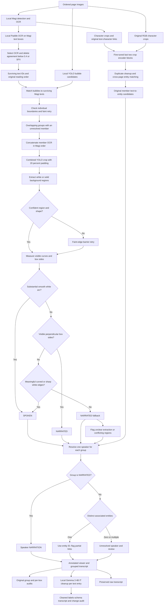

# Contour full inference pipeline

[Practical README and run guide](README_CONTOUR_FULL_INFERENCE.md) | [All fine-tuning experiments](../../FINETUNING-EXPERMENTS/README.md)

Run `pipelineContourFullInference.ipynb` top to bottom in godfather.venv. Configure sequence, optional page number, local models, character checkpoint and contour thresholds near the top. Compatible inference caches are reused; missing stages run locally. The original pipeline and test notebooks are unchanged.

## Character model and association

Original local Magi (`C:/MODELS/magiv2`) supplies detections, clusters and text-character links. The existing `fineTuningMagiCharSimHeads2/magi_crop_last_2_blocks.pt` checkpoint patches only the last two character crop encoder blocks after original detections/associations. Original RGB character embeddings, duplicate cleanup and the validated cosine threshold 0.82 identify sequence-local entities E1, E2, ... . The original matching head is used by default; an optional association-head checkpoint is configurable. The detector is not fine-tuned by this notebook.

## Grouping and roles

Only surviving Magi texts participate. OCR agreement strictly below 0.4 or SFX anywhere in Magi/Paddle/selected OCR deletes a box. Missing agreement is retained unless SFX occurs. YOLO candidates without surviving text matches are ignored. Overlap components are considered only when an individual boundary is unresolved, including verified neighbors. No successful merged boundary is required for concatenation. First proposal wins deterministically for competing text memberships; ambiguity is flagged. Each surviving text is emitted once, in original Magi order; members of a group are joined with spaces, without correcting OCR or hyphenation.

`contour_narrator2.py` snapshots the plain, tested functions from `testContourNarrator2.ipynb`; it does not execute the notebook. `contour_grouping.py` provides existing boundary/group proposal checks. Settings are editable in the pipeline. A combined bubble crop is padded by 20% per side; all member text rectangles are excluded from color statistics. Every member must be covered. Confident first passes are preserved. Missing/uncertain regions get a local-contrast and low-gradient faint-edge barrier retry without closing the white mask across faint lines.

Real smooth arcs are evaluated by length relative to typical member text size, turning, bulge and directional consistency. This avoids a whole-group curve fraction that changes with horizontal/vertical layout or number of members. Strong white curves override box-like approximations. Otherwise actual straight perpendicular sides establish a caption; rectangularity alone does not. Remaining meaningful curved/sharp white boundaries establish speech. No region is a narration fallback. Uncertain/leaking regions or conflicting disconnected member regions are narration with review. Crop borders never count as shape evidence. These are inspectable heuristics, not calibrated probabilities.

## Final speaker rules

Narrated groups use NARRATION. Spoken groups use the single distinct entity from original member associations. One entity with unlinked members uses that entity with review. No entity or competing entities produce null speaker with review. There is no majority vote or nearest-character guess. Original member associations remain available even when a group is narrated. No narration classifier, DeBERTa, DINO or tail override is used.

## Caches and outputs

New files are under `paddleOCR-Magi/cache_contour_full_inference/<split>/<sequence>/<sequence-or-page>/`. Compatible original inference stage payloads are copied into this separate cache after signature/checksum checks. Existing full-pipeline and standalone YOLO caches are reused when compatible. Raw original detections remain intact; deletion affects grouping/transcript membership only.

The `outputs/` folder contains:

- `dialogue_pages.json` and `transcript.txt`: one ordered row per surviving group or standalone text.
- `group_predictions.json/.csv`: role, reason, final speaker, member IDs, original links, region/arc metrics and review flags.
- `box_predictions.json/.csv`: every original box, deletion status and group/final-speaker mapping.
- `deleted_ocr.json/.csv`, `grouping_audit.json`, `entities.json`, `run_metadata.json`.
- Optional annotated page PNGs through the final notebook cell.

Masks are recreated on CPU only when inspecting a group; model inference is not rerun by the viewer. Detailed audit speakers remain null when unresolved; schema-compatible transcripts use UNKNOWN. Review flags preserve uncertainty; fallback narration does not imply a positively detected caption.

## Schema-compatible transcript export

The final cells export transcript.json and transcript.jsonl in the exact development/labels.jsonl structure: one object with sequence_id and pages, with only speaker/text keys in each page row. Resolved predicted entities become stable sequence-local character1, character2, ... names; narrated groups use NARRATION and unresolved spoken groups use UNKNOWN. The numbering does not imply GT identity alignment. transcript_speaker_mapping.json retains the entity-to-character mapping; full review/association details remain in group/box prediction exports.

Original sequence page slots are preserved. In single-page mode, unprocessed pages are empty lists. The final notebook cell prints the entire sequence object. transcript.txt uses the same speaker names in readable form. Each run overwrites its own transcript.jsonl with one sequence line, avoiding duplicate entries on reruns.

## Final Gemma OCR-text cleanup

After grouping and speaker attribution, the notebook uses local C:/MODELS/gemma-3-4b-it in 4-bit with the approved few-shot OCR-restoration prompt. Each transcript text entry is corrected independently; speaker IDs, group membership, page order and entry counts are unchanged. Original OCR remains in transcript_raw.json/.jsonl/.txt and detailed group/box/dialogue exports. Final transcript.json/.jsonl/.txt and the final print cell contain cleaned text. transcript_cleanup_audit.json records raw/cleaned pairs, changes and empty-response fallback.

Compatible gemma_transcript stage caches skip model loading/generation. Input, prompt, model identity and algorithm changes invalidate cleanup separately from OCR/contour stages. The model is released after cleanup. Rerunning always starts from original group OCR, not previously cleaned text. Empty generated text falls back to original text; model edits still need review.
