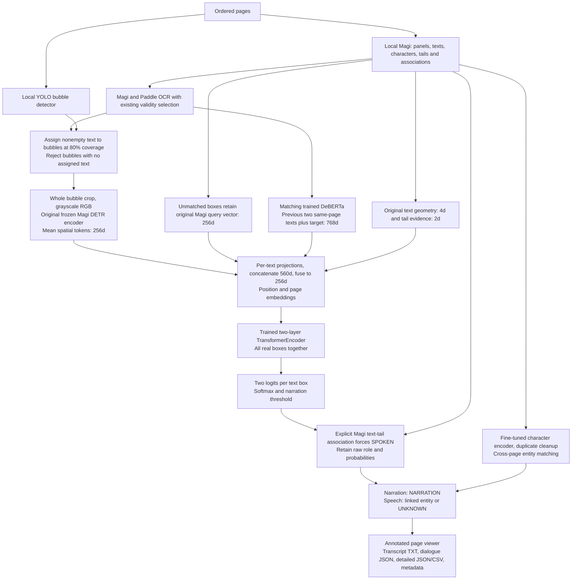

# Trained bubble narration: full inference

Run `pipelineWbubbles.ipynb` in a fresh Godfather kernel. Set sequence/paths in cell 2.
Default is three ordered pages; `PAGE_NUMBER` optionally selects one page with reduced context.
Classifier and matching DeBERTa load from `NarrationModelwBubbles/runs_classifier_resume_v1_tuned_Bert/`
(`best.pt`, `deberta/`, `inference_config.py`). The saved best epoch is printed, not hardcoded.
The bubble checkpoint feature contract is required and checked against all encoders/settings.
There is no fallback to a baseline classifier. Original notebooks and training files are preserved.

Multiple texts in a bubble share the visual vector but receive individual predictions. Uncovered and
empty-OCR boxes stay in sequence context. Bubble presence alone never forces SPOKEN.
The hard tail rule uses an explicit Magi text-tail association, not merely a high affinity score;
it applies to the associated text only. `TAIL_FORCE_SPOKEN=False` disables it.
Tail associations are predictions, not human-confirmed annotations. Audit fields include
`model_text_role`, `text_role`, `tail_override`, `decision_source`, `associated_tail_indices`,
`tail_score`, `bubble_id`, `bubble_bbox`, and `visual_source`. Model probabilities are never rewritten.

Existing compatible caches are discovered and missing stages computed on demand. The tail rule is
cached separately from classifier predictions. The original page viewer, OCR selection, character
clustering and speaker resolution are retained. Bubble previews show retained/rejected candidates.
Local-only model loading is enabled; no training or GT labels are used.

Outputs are under the selected sequence's cache in
`NarrationModelwBubbles/cache_selected_ocr/full_pipeline/<split>/<sequence>/sequence/pipelineWbubbles_outputs/`
(or its selected-page/association namespace). They include `transcript.txt`, `dialogue_pages.json`,
`box_predictions.json`, `box_predictions.csv`, `entities.json` and `run_metadata.json`.
`show_page`/`inspect_text` support review; optional annotated PNGs can be saved through `show_page`.
Only dialogue export optionally filters essential text; the classifier always sees every box.
