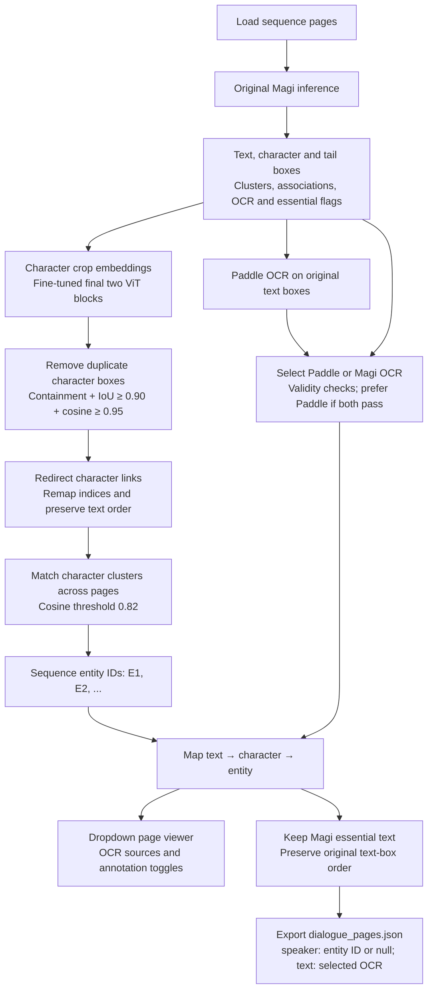

# Magi inference pipeline

Source notebook: [pipelineINFERENCE.ipynb](pipelineINFERENCE.ipynb)

Character overlap removal is included in Section 6, **Remove duplicate character appearances**. An inner character box is removed only when all three conditions hold:

- It is fully contained inside a retained outer box.
- Intersection over union (IoU) is at least **0.90**.
- Character embedding cosine similarity is at least **0.95**.

Text-to-character links are redirected to the retained character, and character indices are remapped. Text boxes, OCR order, and text-to-tail links stay unchanged. Removal decisions are recorded in `character_cleanup.json`.

The notebook uses no ground-truth labels and currently does not run Qwen narration classification. Inference caches and exports are stored under `cache_inference/test/<sequence_id>/`.

The diagram is stored as an editable fenced `mermaid` block. A Markdown viewer with Mermaid support renders it as a flowchart; other viewers may display its source code.
