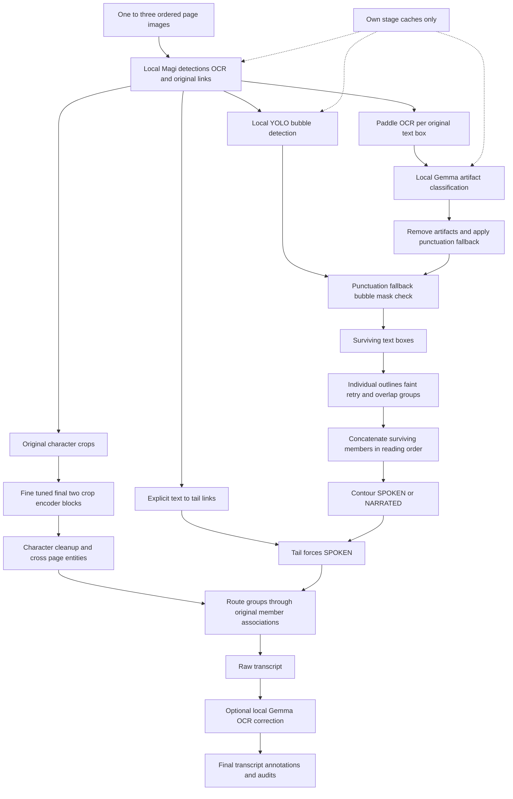

# Artifact + contour full inference

Only the notebook's own stage caches are reused. Dependencies and hashes are exported. No labels, learned narration classifier, other notebook execution or legacy cache discovery is required.
