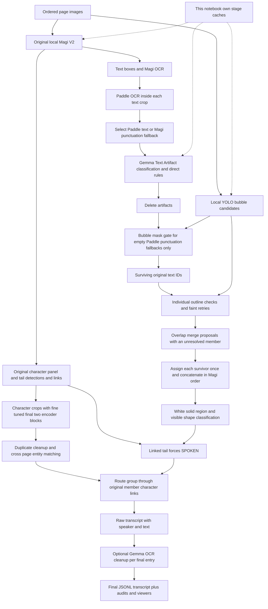

# Artifact + contour full inference: how it works

This is the detailed guide to the pipeline I kept: its inputs, models, contour checks, character matching, caches and outputs. The [main README](../README.md) explains how I got here, and the [batch guide](README_BATCH_INFERENCE.md) covers the Python runner. Ideas under future work are separate from the current implementation.

## 1. Files and what to preserve

Project paths below are relative to `Magi ----- FINAL PIPELINE/` inside the Applied-Task repository, unless marked absolute.

| File | Purpose |
| --- | --- |
| `Final-Pipeline-Code-Inference/pipelineArtifactContourFullInference.ipynb` | Current complete inference entry point; run top to bottom |
| `Final-Pipeline-Code-Inference/contour_narrator2.py` | Background-region extraction, shape measurements and spoken/narrated decisions |
| `Final-Pipeline-Code-Inference/contour_grouping.py` | Individual outlines, faint retries and overlap merge candidates |
| `Final-Pipeline-Code-Inference/PIPELINE_ARTIFACT_CONTOUR_DEPENDENCIES.json` | Static resource/helper list and code provenance |
| `Final-Pipeline-Code-Inference/PIPELINE_ARTIFACT_CONTOUR_FULL_INFERENCE.md` | Earlier standalone Mermaid diagram; consolidated diagram is below |
| This README | Detailed pipeline explanation and possible next steps |
| `Final-Pipeline-Code-Inference/pipeline_review/audit_saved_outputs.py` | Separate saved-output inspection; no model loading or prediction edits |
| `Final-Pipeline-Code-Inference/pipeline_review/saved_output_audit.json` | Historical saved-output audit |
| `TaskData/score.py` | Exact JSONL validator and evaluation definition |

`pipelineContourFullInference.ipynb`, `ArtifactGemmaTest.ipynb` and the older `pipelineFULL_INFERENCE.ipynb` are code origins, not runtime notebook dependencies. Relevant functions were copied into the current notebook. Keep both contour Python files together: the narrator helper imports its sibling grouping file.

## 2. Required environment and local resources

Use the existing kernel at `C:/Users/ESHAAN/BYTE/godfather.venv/Scripts/python.exe`. Import Torch before Paddle on this Windows setup. The current notebook requires CUDA for Magi, Paddle and Gemma; changing DEVICE to CPU does not make the whole pipeline run on CPU.

Required packages include torch, torchvision, transformers, accelerate, bitsandbytes, paddlepaddle-gpu, paddleocr, paddlex, ultralytics, scipy, opencv-python, numpy, pandas, Pillow, matplotlib and IPython. ipywidgets provides the interactive viewers. The root [requirements.txt](../../requirements.txt) records the local package versions and explains the separate CUDA framework setup. A clean installation has not yet been tested.

| Resource | Current configured location | Role |
| --- | --- | --- |
| Magi V2 | `C:/MODELS/magiv2` | Detection, Magi OCR, original associations and page-local character clusters |
| Character checkpoint | `FINETUNING-EXPERMENTS/fineTuningMagiCharSimHeads2/magi_crop_last_2_blocks.pt` | Fine-tuned final two character crop encoder blocks; expected checkpoint epoch 20 |
| Gemma 3 4B IT | `C:/MODELS/gemma-3-4b-it` | Text-only artifact classification and optional final OCR correction; 4-bit NF4 loading |
| YOLO bubbles | `C:/MODELS/manga_bubbles/bubbles_detect.pt` | Candidate bubble rectangles; imgsz 1024, confidence 0.25 |
| Paddle detector | `C:/Users/ESHAAN/.paddlex/official_models/PP-OCRv5_server_det` | Detect text lines within each Magi text crop |
| Paddle recognizer | `C:/Users/ESHAAN/.paddlex/official_models/en_PP-OCRv5_mobile_rec` | English recognition of those lines |

All resource paths are configurable in the notebook's local-resource settings cell. Local Hugging Face model folders must include their configuration, tokenizer, weights and required custom code. Model loading uses local files; existing project inference caches and training labels are not prerequisites.

The character checkpoint is a required model resource, not a reusable data cache. Its metadata and original Magi weight hashes are checked. The original Magi detector and text-character association head remain active: `ASSOCIATION_HEAD_PATH=None`. The notebook does not fine-tune them at inference time.

DeBERTa, DINO, QuoteCaster, the earlier learned narration Transformer, the contour MLP and CatBoost are **not used in this baseline**. I use the pretrained bubble checkpoint linked in the model table below.

## 3. Inputs and run order

The notebook accepts ordered images, not reference transcripts.

- Dataset mode: set `MAGI_ROOT`, `SPLIT`, `SEQUENCE_ID`, `PAGE_NUMBER=None`. It reads numeric PNG filenames under `TaskData/<split>/images/<sequence_id>/` in sorted filename order. For submission, verify that the three pages are in the intended order, preferably zero-padded names such as 01.png, 02.png, 03.png.
- Standalone mode: set `INPUT_IMAGES=[Path(...), Path(...), Path(...)]` in reading order. Arbitrary image filenames are supported; TaskData and labels are unnecessary.
- One-page inspection: set PAGE_NUMBER in dataset mode, or provide one explicit image. This is an inspection mode, not a complete three-page prediction.

Run all cells in order in a fresh kernel. Configure `CLEAN_TRANSCRIPT=True/False` before running; True is the current default. Configure `FORCE_ALL=True` only when regenerating this notebook's own stages is intended.

Magi/Paddle inputs are grayscale converted back to RGB. Original RGB page arrays are retained for character crops and contour inspection. Do not silently change these preprocessing choices when packaging.

## 4. Complete flow



### A. Magi and character entities

Original Magi first produces text, character, panel and tail boxes, OCR, page-local character cluster labels, text-character links and text-tail links. Preserve original text indices throughout: `PG1:T9` identifies the ninth original text detection on page 1, even if earlier detections are deleted.

The fine-tuned final two crop encoder blocks then produce normalized 768-dimensional character embeddings. They do not rerun or retrain the original text-character association head.

Contained duplicate character appearances are removed when IoU >= 0.90 and embedding cosine >= 0.95, with association indices remapped. Cross-page matching uses the existing page clusters and strongest member-pair cosine, threshold 0.82. Candidate matches are accepted greedily in descending score, allowing one page cluster per existing entity on that page. Unmatched clusters become new entities. These are anonymous identities within this sequence; they are not named characters or global identities across sequences.

### B. Paddle selection and artifact deletion

Paddle runs a full detector + recognizer on each original Magi text crop. The notebook joins returned line strings and records line confidence and errors. It does not currently retain each Paddle line polygon in that record.

| Situation | Current behavior |
| --- | --- |
| Nonempty Paddle text | Select Paddle; Gemma sees that one string, without Magi text, images or neighboring dialogue |
| Punctuation-only Paddle | Retain as Text directly, before Gemma |
| Empty Paddle and punctuation-only Magi | Select Magi punctuation as Text, then require the bubble-mask gate |
| Empty Paddle and other Magi text | Artifact/deletion; ordinary Magi sentences are not a fallback |
| Gemma returns exactly Text | Retain |
| Gemma returns exactly Artifact | Delete |
| Unexpected Gemma answer | Retain as Review |

Gemma receives the system prompt and the embedded few-shot examples, followed by one Paddle string. Identical Paddle strings share a classification within the run. Generation is greedy with at most eight new tokens. It is text classification, not visual artifact recognition.

The exact prompt/examples remain in the notebook. They protect names, integers, multiple sentences, punctuation and human vocal reactions, and reject SFX, noise, links and watermarks. There are policy tensions: “single text characters are artifacts” versus legitimate I/A/0; Japanese names/words are allowed while particular Japanese examples are marked Artifact. These are proposed review points, not silently corrected policies.

**The old agreement < 0.4 deletion is absent here.** Magi/Paddle agreement is diagnostic only. There is no separate fuzzy watermark/SFX deletion and no contour rescue of a Gemma Artifact.

### C. Bubble gate, outline grouping and concatenation

YOLO bubble candidates are auxiliary geometry. YOLO cannot introduce text absent from the surviving Magi/Paddle set.

Only empty-Paddle/Magi-punctuation fallback boxes receive the extra bubble-mask gate. A matching YOLO candidate must cover at least 80% of the text rectangle; its approximately 20%-expanded crop must yield a qualifying surrounding region with enough visible evidence and no suspected leakage. Unsupported fallback punctuation is deleted. Other Gemma Text/Review boxes do not pass through this special deletion gate.

Two contour tasks are distinct:

1. **Individual outline checking** decides whether a candidate already has sufficient real drawn boundary evidence. Normal checks run first; failed candidates may receive a faint-line retry. Crop borders are not drawn outline evidence.
2. **Overlap grouping** uses the original YOLO rectangles, not padding-created overlap. Candidate overlap groups need at least one unresolved individual boundary; already verified neighbors can participate. Matching surviving Magi text IDs are assigned deterministically. A successful merged enclosing outline is not required to concatenate.

Each surviving text appears exactly once in the resulting groups, otherwise an assertion fails. Members are concatenated in Magi text-index order, and unmatched text stays standalone. This does not prove a proposed merge is semantically correct or that all group members share one speaker.

### D. Spoken versus narrated

For each unit/group, the helper examines the surrounding white or dominant-color mass in padded candidate crops. Text rectangles are excluded from appearance measurements. Important defaults include text coverage >= 0.90, surrounding area >= 1.15 times text area, outside-text fraction >= 0.15, white or solid fraction >= 0.85, and at least 16 visible boundary samples. These region thresholds are distinct from the stricter individual-outline grouping thresholds.

Real visible edges are used for shape; artificial crop edges are excluded. Meaningful continuous curves require sufficient physical length, turn, bulge and directional consistency. Supported perpendicular straight sides support a caption-box interpretation. Strong white curves can override a rectangular interpretation, including curved merged groups in either orientation. White expressive curved/sharp shapes support SPOKEN. Box-like regions support NARRATED. No qualifying region and weak/leaking extraction fall back to NARRATED with review information where applicable.

A linked original Magi tail on **any surviving group member always forces SPOKEN**. This is an explicit user-chosen heuristic, not a certainty established by a second model. A detected tail elsewhere on the page does not trigger it. The notebook does not estimate a tail-tip direction or retrain associations.

### E. Speaker routing and final text

NARRATED becomes `NARRATION`. For SPOKEN groups, original member character links are mapped through the final sequence entities:

- Exactly one entity across linked members: assign it. Missing links on other members make this a partially linked review case.
- Multiple conflicting entities: UNKNOWN and review.
- No linked entity: UNKNOWN and review.

Tail existence establishes the spoken role, not the speaker identity. The notebook does not guess the closest character or reassociate from the merged rectangle. Entity IDs E1/E2/... become stable sequence-local `character1`, `character2`, ... in the exported transcript.

Optional Gemma cleanup runs on each final entry's text after grouping and speaker assignment. It receives no speaker IDs. Punctuation-only entries bypass correction; empty answers fall back to raw text. Structure and speakers are asserted unchanged, but semantic fidelity is not guaranteed by those assertions. Keep raw and cleaned exports separately.

## 5. Caches and dependencies

Own cache layout:

```text
Final-Pipeline-Code-Inference/cache_artifact_contour_full_inference/
  <sequence_id>/<hash_of_ordered_image_paths>/
    manifest.json
    magi_raw.json
    embeddings.json
    paddle_ocr.json
    ocr_selection.json
    artifact_labels.json
    artifact_filter.json
    character_cleanup.json
    entities.json
    text_entities.json
    contour_bubbles.json
    contour_roles.json
    contour_speakers.json
    gemma_transcript.json
    outputs/
```

The scope uses ordered absolute image paths; stage signatures additionally include image content hashes and relevant settings/dependencies. Matching own-cache payloads are reused; absent or incompatible stages are computed. There is no old-experiment cache discovery. FORCE settings allow regeneration.

Static dependencies JSON records helper hashes and inline-code origins. Per-run `outputs/dependencies.json` records actual resources; `run_metadata.json` and manifest record stage settings and signatures. Some weight identities use file size/mtime rather than full weight SHA256; do not describe every resource as fully content-hashed. Full content hashes and complete package locking are future packaging improvements.

## 6. Outputs and exact JSONL contract

Each physical JSONL line contains exactly one sequence object:

```json
{"sequence_id":"seq_example","pages":[[{"speaker":"character1","text":"WAIT!"}],[{"speaker":"NARRATION","text":"Later that day..."}],[]]}
```

For the normal task, pages must contain **exactly three lists in image order**. Each entry has exactly `speaker` and `text`, both valid nonempty strings; speaker strings must be trimmed. Empty pages use `[]`. Do not add confidence, boxes, IDs or review fields to submission entries: retain those in sidecar audits.

Dataset one-page mode preserves original page slots with other pages empty; it does not predict the omitted pages. Explicit-image mode emits one slot per supplied image. A one/two-page explicit run therefore needs a distinct inspection contract and cannot pass the default three-page submission validator.

`characterN` numbering is sequence-local. The scorer matches predicted identities to reference identities within the whole sequence; exact character numbers are not fixed names. NARRATION remains a fixed identity. Predicted UNKNOWN is **not ignored**: it is treated as an anonymous predicted speaker. Sharing UNKNOWN across unrelated unresolved speakers can therefore collapse identities.

| Export | Meaning |
| --- | --- |
| `transcript.jsonl`, `.json`, `.txt` | Final cleaned text if cleanup enabled; otherwise raw text |
| `transcript_raw.*` | Original selected/grouped OCR before final Gemma cleanup |
| `transcript_cleanup_audit.json` | Entry-level raw/cleaned edits |
| `transcript_speaker_mapping.json` | Entity-to-character name mapping |
| `box_predictions.json/.csv`, `deleted_ocr.json/.csv` | Every original box and deletion outcome |
| `group_predictions.json/.csv`, `dialogue_pages.json` | Groups, members, original group OCR, roles, associations and review status |
| `grouping_audit.json` | Individual checks, merge proposals and assignment decisions |
| `artifact_decisions.json`, `artifact_filter_audit.json` | Gemma/direct decisions and punctuation bubble checks |
| `entities.json` | Character groups and matching decisions |
| `dependencies.json`, `run_metadata.json` | Actual resources and stage provenance |

Detailed group/box exports retain original OCR even after final transcript cleanup. The notebook prints the final transcript after cleanup. Viewers expose selected pages, OCR sources, deleted text, contours, characters, tails, roles, IDs, entity colors, links and same-entity relations. `inspect_group(...)` and `inspect_final_text(...)` provide detailed manual inspection. Viewing does not change predictions.

## 7. What the scorer actually rewards

`TaskData/score.py` measures ordered text similarity, matched-token coverage, speaker accuracy on aligned tokens, joint text/speaker F1, and balanced joint F1. It does not directly score contour quality, bubble masks, face boxes or attractive annotations. Text alignment is monotonic within each page, so reading order matters. Speaker identity matching spans the sequence and NARRATION cannot be renamed to an ordinary character.

Practical implications: a correct bubble cannot compensate for deleted dialogue; fluent rewritten dialogue can reduce text fidelity; a wrong merge can assign multiple speakers' words to one identity; a correct OCR line can still have the wrong speaker. Schema validation alone proves none of these are accurate.

The [metrics guide](../METRICS.md) explains the completed development scores and how inconsistent character IDs affect balanced joint F1.

## 8. Checks performed without ground truth or inference

The separate audit inspected the one saved run for `seq_2fae297a18af2a57`, scope `a922ef5f36d9a3aa`:

| Check | Observed saved output |
| --- | --- |
| Raw and final JSONL | Both pass the actual scorer's default schema loader |
| Original / deleted / surviving boxes | 28 / 4 / 24 |
| Output groups / membership | 21 groups; every surviving box appears once |
| Roles / tail overrides | 21 SPOKEN; 20 tail-forced groups |
| Speaker links | 19 linked, 2 unassociated review groups |
| Noncontiguous merged members | None flagged in this run |
| Final OCR cleanup | 6 changed entries; 1 numeric-preservation flag |

The historical audit flagged a cleanup edit that changed a number-like token. I keep raw and cleaned text for checking these edits. A separate numeric-change check is an inspection tool, not an active correction rule in the pipeline.

Pure-function checks also confirmed: empty Paddle plus an ordinary Magi sentence is deleted; empty Paddle plus Magi `...` takes the punctuation fallback; I and 0 go to Gemma rather than a hard single-character deletion rule. Tilde-only strings are not protected by the Python punctuation check because Unicode classifies tilde as a symbol, and therefore go to Gemma. The three cached watermark deletions and the fourth empty-Paddle deletion were logged, not evaluated against GT.

This table describes one historical saved run, not the full development evaluation. It checks file structure and decisions, not prediction accuracy. The saved files were not regenerated for this documentation.

Reproduce the audit from the Magi directory, using PowerShell:

```powershell
& C:/Users/ESHAAN/BYTE/godfather.venv/Scripts/python.exe `
  Final-Pipeline-Code-Inference/pipeline_review/audit_saved_outputs.py `
  Final-Pipeline-Code-Inference/cache_artifact_contour_full_inference/seq_2fae297a18af2a57/a922ef5f36d9a3aa/outputs `
  --report Final-Pipeline-Code-Inference/pipeline_review/saved_output_audit.json
```

The audit reads saved predictions and imports the schema loader from score.py. It never calls evaluate(), reads labels.jsonl, loads model weights, or edits prediction files. Its default schema check expects three pages.

## 9. Improvement candidates, kept outside the baseline

These are things I could try next, not changes already made to the pipeline. I would compare them separately before replacing the current version.

| Priority | Candidate | Reason and smallest useful test |
| --- | --- | --- |
| 1 | Guard final OCR correction | Compare raw and proposed edits; flag changed digit-bearing tokens, names, negation and large deletions. Revert or queue uncertain edits; preserve raw output. The included numeric flag is a prototype only. Do not assume a simple edit-distance threshold protects meaning. |
| 2 | Retry OCR failures before deletion | Errors, invalid crops and genuine empty recognition currently reach the same empty-Paddle path. Retry operational failures first; separately test scale/contrast/inversion variants only for empty/low-confidence crops. Never treat failed inference as evidence of an artifact. Do not blindly restore Magi text: the saved empty case is highly repetitive/noisy. |
| 3 | Keep OCR line geometry | Paddle currently recognizes each crop independently, so overlapping Magi crops may capture neighboring letters or lines. Preserve Paddle polygons and assign detected lines to original Magi regions by deterministic coverage/center ownership. Review boundary-spanning lines rather than deleting duplicate words globally. Genuine repetitions must remain. |
| 4 | Make artifact policy consistent | Test I, A, 0, unfamiliar names, Japanese names, punctuation, screams, SFX, codes and multiline dialogue in a separate policy fixture. Resolve prompt/example conflicts deliberately; keep identical inputs stable and all decisions auditable. |
| 5 | Restrict classifier answer format | Limit Gemma completion to token sequences for Text/Artifact or score the complete two label sequences. Handle multi-token labels and termination properly. This reduces malformed answers, not wrong classifications; use a calibrated review policy if abstention is required. |
| 6 | Audit merge safety and order | Keep grouping separate from recovery of a perfectly closed merged outline. Flag proposals with conflicting character entities, unrelated panels or interleaved non-member text indices. Preserve every original member ID and text in sidecars. Splitting a suspicious group is an experiment, not an automatic baseline change. |
| 7 | Separate extraction uncertainty from narrator evidence | Failed/leaking extraction currently defaults to NARRATED. Internally distinguish “caption evidence” from “unknown shape.” Examine clipped-page bubbles and faint outlines separately; keep tail override policy explicit. Do not claim every rectangle is narration or every missing outline is an artifact. |
| 8 | Improve unresolved identity handling cautiously | Tail-forced groups may still be unassociated, as in the saved run. Compare existing original candidate links and explicit tail geometry in a separate audit; neither nearest-character guessing nor text semantics alone reliably establishes a speaker. Cross-page greedy matching can be compared with globally optimal assignment, but identical pair scores do not guarantee better identities. |
| 9 | Harden batch export and reproducibility | Verify expected sequence IDs/pages, reject duplicate IDs and invalid/empty entries, write UTF-8 atomically, and keep per-sequence sidecars. Pin packages, preprocessing, model hashes and helper code. Run failures must be surfaced rather than silently exporting partial sequences. |

Research details:

- Paddle exposes a recognition-only module for **text-line crops**, with local model directories and confidence outputs. This supports testing recognition retries on existing line crops, avoiding another detector failure. It does not imply that a multiline Magi rectangle should be fed wholesale to a single-line recognizer. Use the installed API and existing local model explicitly; online documentation defaults may refer to newer models. [Official Paddle recognition module](https://www.paddleocr.ai/latest/en/version3.x/module_usage/text_recognition.html).
- Transformers exposes generation constraints through `prefix_allowed_tokens_fn` and logits processors. A token-prefix restriction is a way to enforce valid label completions, not a way to improve semantic evidence. The label-scoring alternative is a proposed experiment, not tested Gemma calibration. [Official Transformers generation API](https://huggingface.co/docs/transformers/main_classes/text_generation).
- Magi's official V2 interface provides chapter-wide predictions, OCR and character associations. Retaining those indices and separating custom contour decisions from original links follows the available interface. The project's original optional essential-text filter is not active in this custom pipeline. [Official Magi repository and V2 usage](https://github.com/ragavsachdeva/magi#magiv2).

Suggested next experiment: **guarded cleanup plus OCR-failure retries**, independently switchable in a new notebook/file. These address direct output-loss mechanisms before adding another model. Review image-linked raw/candidate text, deletion reasons, changed numbers, retained boxes, grouping membership and speaker conflicts. Such checks can detect mechanical regressions without development scores; human review or later held-out evaluation is still needed to demonstrate accuracy gains.

## 10. Batch entry point and possible later packaging

[run_sequence_inference.py](run_sequence_inference.py) already runs the pipeline over a split from TaskData/sequences.json. It uses the Python worker and shared-model scheduler described in the [batch guide](README_BATCH_INFERENCE.md); the notebook is not executed at runtime. Scoring is a separate step.

A later code.py entry point could wrap this same flow. It would need the two contour helpers, model resources and environment setup. It should preserve page order, reset entity IDs between sequences, validate each output and report failures instead of substituting empty transcripts. Reference labels define the format and support evaluation; they are not inference input.

The notebook keeps the viewers for inspection. The batch runner runs without them. Both create their own stage caches rather than depending on an old experiment's caches.

## 11. GitHub source, model links and checkpoint hosting

The repository root is Applied-Task. Its `.gitignore` excludes environments, secrets, weight/feature binaries, most training-run contents, input images/reference labels and stage-cache internals. The selected two-block character checkpoint and small experiment summaries are explicit exceptions. It deliberately does not ignore JSON/JSONL/CSV or outputs directories globally. Final predictions and score reports remain uploadable. In the current cache tree, transcript.jsonl, transcript_raw.jsonl, predictions.jsonl, predicted_labels.jsonl, submission.jsonl and conventional score JSON filenames are explicitly retained. Other cache internals remain ignored.

Use `Magi ----- FINAL PIPELINE/submission_outputs/` for final predictions and score.py reports. Files there can use any sensible JSONL/JSON/CSV names without being hidden by a cache directory rule. Existing experiment-local .gitignore files may still exclude their own caches; the dedicated submission folder avoids that ambiguity. Git ignore rules do not remove files already tracked in an existing repository.

Model-source links are also listed beside resource settings in the notebook.

| Resource | Hugging Face source |
| --- | --- |
| Magi V2 | [ragavsachdeva/magiv2](https://huggingface.co/ragavsachdeva/magiv2) |
| Gemma 3 4B IT, artifact and cleanup stages | [google/gemma-3-4b-it](https://huggingface.co/google/gemma-3-4b-it) |
| Bubble YOLO, bubbles_detect.pt | [PSImera/manga_bubbles_detect](https://huggingface.co/PSImera/manga_bubbles_detect) |
| Paddle detector | [PaddlePaddle/PP-OCRv5_server_det](https://huggingface.co/PaddlePaddle/PP-OCRv5_server_det) |
| Paddle English recognizer | [PaddlePaddle/en_PP-OCRv5_mobile_rec](https://huggingface.co/PaddlePaddle/en_PP-OCRv5_mobile_rec) |
| Fine-tuned character checkpoint | [Checkpoint and usage guide](../FINETUNING-EXPERMENTS/fineTuningMagiCharSimHeads2/README.md); requires Magi V2 |

The bubble repository provides the checkpoint used by this pipeline. The local bubble SHA256 is `8f953bce05813fa68c9c99d487cb7c6a4fd38bb827ac5ab4bca042b209a0f744`.

### The character checkpoint

I keep `magi_crop_last_2_blocks.pt` with the project, with an exact exception in the ignore rules. Other weight files and training tensors remain excluded. The [short usage guide](../FINETUNING-EXPERMENTS/fineTuningMagiCharSimHeads2/README.md) explains the Magi V2 dependency, epoch 20, entity threshold 0.82 and loading order.

This checkpoint updates only the final two character crop-encoder blocks. The pipeline checks its base-file hashes and runs original Magi detections and links before applying it. It does not replace the full Magi model.

Pretrained Gemma, Paddle, Magi and YOLO weights stay outside the code repository; their upstream links are in the table above and the [complete model list](../README.md#model-links).

## 12. Archived Magi pipelines

Older notebooks, contour/artifact tests, previous pipeline guides and their caches now live in [LegacyMagiPipelines](LegacyMagiPipelines/README.md). The active notebook, contour_narrator2.py, contour_grouping.py, this guide, dependency JSON, flowchart, pipeline_review and cache_artifact_contour_full_inference remain directly in Final-Pipeline-Code-Inference. Inline-code origin notebooks are historical provenance only and now point into the archive; they are not executed at runtime.


## 13. Batch sequence inference

Use [run_sequence_inference.py](run_sequence_inference.py) with `--split test` or `--split development`. It reads ordered images from TaskData/sequences.json and writes complete schema-validated predictions to submission_outputs/inference_<split>/predictions.jsonl. It does not read labels.jsonl or perform scoring. [README_BATCH_INFERENCE.md](README_BATCH_INFERENCE.md) covers options, caches, logs and the later score.py command. The headless Python snapshot lives in src/artifact_contour_sequence.py; the notebook provides the interactive version of the same pipeline.


## 14. Shared-model batch scheduling

The batch runner now processes the same sequence stages across all selected sequences with shared model lifetimes; see [batch scheduling and regression checks](README_BATCH_INFERENCE.md#shared-model-schedule-and-workflow-tests). Original Magi results for every sequence finish before any fine-tuned crop patch is applied. Paddle, artifact Gemma, YOLO, contour/routing and cleanup Gemma retain their original per-sequence order. Five CPU-only regression tests passed using stubs and saved data. A real GPU comparison has not been run.

## Folder-name note

The repository folders were renamed after the saved run. Some notebook, worker and model-config defaults still contain the earlier Magi/paddleOCR-Magi paths. Those settings need updating before another inference run. This documentation cleanup does not change runtime code.
