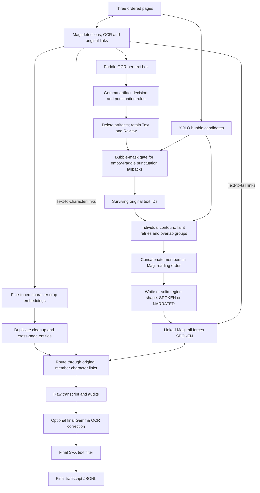

# Manga transcript extraction

My goal was to turn three ordered manga pages into a transcript with the text in reading order, a speaker for each line, and narration marked separately.

I tried quite a few things before settling on this pipeline. It still makes mistakes, but I can usually trace what happened. Here is how I got here, what worked, and what I would try next.

I combine **Gemma artifact filtering, contour-based speech/narration detection, joined-bubble grouping and character assignment**.

## What I tried

Before Magi, I tried direct Qwen transcripts, separate YOLO bubbles, Paddle OCR, face/body detection, InternVL association and DINO identity features. I also tested artifact checks, crop variations, repeated seeds and Optuna settings.

### Models I trained or tried training

- **Qwen transcript LoRA:** I tried end-to-end training, but even the baseline struggled with page formatting and repeated text.
- **InternVL weighted-token adapters:** The VL model was getting better at producing JSON without reliably getting the decisions right, so I tried giving decision IDs more loss weight than JSON formatting tokens. I also tried full-JSON weighting, but I still did not find better results: the generated IDs and quick test outputs remained unreliable. So I switched to a non-VL approach with separate detection, OCR, grouping and speaker-assignment steps.
- **Qwen association LoRA:** I hit GPU memory limits and do not have a confirmed completed comparison.
- **Decoder/projector/vision variants:** I set these up separately, but did not finish every run.
- **Character projection MLP:** I trained projections on cached features, but could not find a clear improvement.
- **Residual character projection:** I got almost the same results, with some metrics up and others down, so I moved on.
- **One-block Magi crop tuning:** I saw validation gains but weaker evaluation results.
- **Two-block Magi crop tuning:** I kept this checkpoint, although the improvement was small.
- **Frozen DINO narration head:** I caught more narration, but also labelled too much speech as narration.
- **Frozen Magi narration MLP:** I got too many false narration labels.
- **Multimodal narration Transformer:** I thought combining visuals, DeBERTa semantics, geometry and positional context would be a big breakthrough. But when I checked the pages, the contour approach gave me better results, so I kept that instead.
- **Padded-DINO narration:** I added more of the surrounding image, but did not get an improvement in the untuned repeated-seed runs.
- **Bubble-crop and DeBERTa tuning:** I added more context, but preferred the contour results when checking pages myself.
- **Qwen role LoRA:** I got too few usable outputs; I do not have confirmed completed runs for the balanced/visual variants.
- **Manga109 association head:** I set up training, but do not have a verified trained head.
- **QuoteCaster fine-tuning:** I saw a little improvement, but it still struggled to separate speakers.
- **Contour/context MLP:** I missed too many narration examples.
- **Contour CatBoost:** I caught more narration, but still had too many false positives.

I kept the two-block crop checkpoint. I recorded more detail, including unfinished runs, in the [experiment guide](Magi%20-----%20FINAL%20PIPELINE/FINETUNING-EXPERMENTS/README.md). EntityClustering was for inspecting the pipeline, not another model I trained.

While looking for other character models, I later found [Re:Cognize](https://github.com/eternal-f1ame/Re-Cognize), which evaluates MagiV2 alongside other backbones. In its [paper, Section 4 and Tables 12–14](https://arxiv.org/html/2609.34032v1), I found that adapting the encoder only gave small improvements. On Re:Verse, released MagiV2 scored 84.2 mAP / 91.0 Rank-1; fine-tuning scored 84.7 / 91.7, and adding memory scored 84.8 / 90.1. After seeing that, I decided I should probably stop spending so much time looking for gains from more fine-tuning and focus on grouping and speaker assignment. Fine-tuning did help a little in their tests, and their baseline trains a BNNeck with the backbone frozen, unlike my crop-block tuning. I still kept my two-block checkpoint.

## What slowed me down

**Local training time was my main bottleneck.** Training, feature extraction and validation took time, and the local 8 GB GPU limited image sizes and model configurations. Some attempts ran out of memory.

I used frozen encoders, small classifiers, LoRA and cached features to keep experiments manageable. I tried repeated seeds and tuning where possible, but could not fully compare every idea.

**Getting enough labelled examples was another challenge.** There were 80 development sequences, with relatively few narration examples. Some validation sets contained only 12 or 13 narration examples, making the metrics sensitive to a handful of mistakes.

I could use the supplied images and transcripts, but training on individual boxes also needed matches between boxes and transcript lines, links to visible speakers, and labels showing which character crops were the same person. I built these labels using OCR matching, existing model links and manual checks. That took extra work, and I could not confidently label every example.

That limited how much I could try, although it does not explain away the mistakes still in the pipeline.

## The pipeline I chose

I run [run_sequence_inference.py](Magi%20-----%20FINAL%20PIPELINE/Final-Pipeline-Code-Inference/run_sequence_inference.py) with the test or development split from TaskData/sequences.json. I do not pass reference labels into inference.

## How the pieces came together

Once I had Magi detections and Paddle OCR, I could recover text, but not yet a reliable transcript. Watermarks, links, sound effects and drawing details also became OCR. Before deciding who said something, I needed to decide whether it belonged in the transcript at all.

I compared dictionary checks, statistical gibberish detection and OCR agreement. Names, reactions and noisy lettering made these unreliable. That led me to local **Gemma 3 4B IT**. I give it one box's Paddle text and examples of Text versus Artifact, without the image or neighboring dialogue. I keep punctuation-only Paddle text directly. If Paddle finds nothing, I only use Magi punctuation when the bubble-region check supports it; I do not fall back to ordinary Magi words. I keep unexpected Gemma answers for review.

This gave me a cleaner set of text boxes, but exposed another problem: **one connected speech bubble could become several detections and separate transcript lines**. I started inspecting contours to understand which fragments belonged together. Individual enclosing boundaries were useful, but faint lines and connected bubbles often prevented a complete outline.

So I stopped requiring a perfect outline just to group the text. I consider overlapping original YOLO rectangles when I cannot find an individual boundary for at least one member; already verified neighbors can join too. I do not count overlaps created only by padding. I match those candidates to surviving Magi/Paddle texts, preserve their IDs and concatenate them in Magi reading order. I leave unmatched text separate and make sure every surviving box appears exactly once. I do not require a closed outline around the merged group. [contour_grouping.py](Magi%20-----%20FINAL%20PIPELINE/Final-Pipeline-Code-Inference/contour_grouping.py) records the members and reasons.

**While working on joined bubbles, I noticed something else:** many narration lines had no surrounding bubble, or sat inside a square or rectangular caption. The contours I was already examining for grouping could also provide evidence about speech versus narration.

I had already tried learning that distinction. My [multimodal narration model](Magi%20-----%20FINAL%20PIPELINE/FINETUNING-EXPERMENTS/NarrationImbalanceTraining/README.md) combined Magi text-object visual features, **DeBERTa semantics from the previous two same-page OCR boxes plus the target**, normalized geometry and tail features. I fused these into 256 dimensions, added learned sequence-position and page embeddings, and used a two-layer Transformer to classify all boxes in a three-page sequence together. Because narration was less common, I sampled whole narration-containing sequences more often and used class-balanced weighted cross-entropy, with effective-number weights calculated from the training split only. I also tried repeated seeds and Optuna. Later variants added padded DINO crops and bubble-crop visuals.

**I thought this multimodal narration Transformer would be a big breakthrough:** it had visual features, text semantics, layout and context together. But even with all that information, I was not happy with some of the predictions when I looked through the pages. **The contour approach gave me better results in those page checks**, and I could see why a decision was made, so that is what I kept. I did not run a comparison that proves contours beat every model. I also did not want to just call everything SPOKEN: that might score reasonably on common cases, but it would miss the point of detecting narration.

I expanded YOLO crops by about **20% per side** and measured the surrounding white or solid-color region, excluding text rectangles from color measurements. I use meaningful curves around a white region, or supported expressive sharp shapes, as evidence for SPOKEN. I use straight sides and perpendicular corners as evidence for NARRATED. Strong curves can override a box-like shape. If the evidence is weak or missing, my current rule falls back to NARRATED and flags uncertain cases for review.

I had to be careful here: a crop edge is not a drawn bubble boundary. I retry faint cases, but clipped or rectangular speech bubbles still cause trouble. I label text with a Magi text-to-tail link as SPOKEN, although the tail link alone does not tell me who said it. [contour_narrator2.py](Magi%20-----%20FINAL%20PIPELINE/Final-Pipeline-Code-Inference/contour_narrator2.py) implements these checks, including region inspection after grouping.

With text retained, fragments joined and roles assigned, I could return to **who was speaking**. I use Magi's original text-character links. My retained checkpoint changes the final two character crop-encoder blocks, not the detector or association head. I use those features to match appearances across pages. I assign narrated groups to NARRATION and spoken groups to a consistent linked entity; missing or conflicting links become UNKNOWN. I restart the IDs for each sequence. I also keep an eye on joined text: in the earlier development analysis, 16 of 186 merged groups aligned to multiple reference speakers, so I would check those images before assuming the grouping was right.

Finally, joined entries sometimes exposed OCR noise that was harder to notice in isolated fragments. I added a separate Gemma call to correct each final entry without speaker IDs. I tried different prompts and input/output examples: the artifact step covers dialogue to keep, artifacts to remove, SFX, non-SFX reactions, names, numbers and punctuation; the cleanup step covers OCR noise to remove and valid text to preserve. I keep raw and cleaned transcripts, original OCR and deletion reasons because either step can still make mistakes, and later contours cannot restore a deleted box.

I also added a final export check that removes an entire entry if its text contains `SFX`, ignoring case. It runs after cleanup even when I reuse cached results. I keep the original OCR and the filter decisions in the audit files.

## Current results and what they show

I completed all 80 development sequences. I used development data for earlier training and tuning too, so I do not treat these scores as an independent final-test result.

| Metric | Result |
| --- | ---: |
| Text order score | 0.908677 |
| Matched token coverage | 0.923951 |
| Speaker accuracy on matched text | 0.638956 |
| Joint F1 | 0.602112 |
| Balanced joint F1 | 0.394984 |

**Overpredicting narration is another reason my speaker accuracy is low.** When I label a spoken line as NARRATION, it loses speaker credit even if I recovered the text correctly: the scorer cannot map NARRATION to a character. I would make reducing those false narration labels a major next fix, alongside more consistent character clustering. I do not expect either change alone to explain or fix every speaker error.

**The main issue I noticed was character clustering.** Text could be linked to the right character crop, but different appearances of the same person sometimes ended up under different entity IDs. So even when the original text-to-character association was right, the final transcript treated that person as multiple speakers. This is why I would focus next on clustering before replacing the association method.

**I checked how this hurts balanced joint F1:** the scorer can match only one predicted entity to each reference speaker. Splitting one person into several entities makes some correctly linked text count as wrongly attributed, and the extra entities also lower the balanced score. Simply using a different character number is fine; using inconsistent IDs for the same person is the problem. That explains how the clustering failures I noticed can compound. I still cannot use the formula alone to say exactly how much of the total error came from clustering.

[METRICS.md](Magi%20-----%20FINAL%20PIPELINE/METRICS.md) explains the calculations. The latest [score report](Magi%20-----%20FINAL%20PIPELINE/submission_outputs/inference_development/score_results.json) and [predictions](Magi%20-----%20FINAL%20PIPELINE/submission_outputs/inference_development/predictions.jsonl) remain available.

I am getting better text recovery than speaker assignment. Balanced joint F1 makes that clearer: getting one character's long conversation right does not make up for missing other characters or inventing extra speaker groups.

In my [earlier development error analysis](Magi%20-----%20FINAL%20PIPELINE/submission_outputs/inference_development/analysis/speaker_error_summary.json), I found 170 extra labels across 79 speaker-scored sequences, and 29 of 272 known reference identities with zero identity F1. About 73% of the wrongly attributed matched-token weight involved spoken identity, and 25% involved speech labelled narration. I predicted narration in 63 sequences, compared with 14 reference sequences. These figures are from before the final SFX filter, not a fresh analysis of the scores above.

The clustering problems I noticed are therefore my first target for improvement. I would still check the original speaker links separately, since association mistakes can also happen. In that earlier comparison, I saw a small improvement in both joint metrics after Gemma cleanup.

Because narration labels were so rare, a simple model that called every box SPOKEN could look good on majority-heavy metrics. I did not want to stop there: I wanted to actually try detecting narration, even if that meant dealing with a harder problem and making mistakes along the way. That baseline would still be useful to measure, but I have not established that it beats this pipeline, especially on balanced joint F1.

Looking through the test outputs, I also noticed **too much text being labelled NARRATION**. I tried several machine-learning approaches before sticking with contour heuristics, because I preferred their results in the pages I checked. Looking back, I think relying on those heuristics was a weak choice for uncertain cases: a missing or unclear bubble region can fall back to narration even when the text is spoken. I would now make a better learned speech/narration model a major priority, ideally combining contour evidence with visual features, text semantics and layout. I expect that could improve the scores, but I would need to test it rather than assume the gain.

## What I would try next

I already have useful inputs: text context, character crops, positions, bubbles, contours and Magi links. Before adding another big model, I would try to get more out of those. The two problems I keep noticing are different people ending up in one identity group, and text being linked to the wrong bubble or character. Different angles, poses and crops make matching harder, but I still need to check whether the feature vectors or the grouping rule caused each mistake.

**I would start by checking a small set of failures.** I would mark which crops are the same person, which texts belong to each bubble, and who speaks each line. A good speaker link still gets the wrong final ID if I have merged two people. Keeping those two problems separate should make it easier to see what actually needs fixing.

**For character grouping, I would be more careful about merging.** Instead of trusting one similar pair, I would compare against several reliable views of each character and check how close the next-best match is. If one new crop connects two groups that otherwise look different, I would flag it. Uncertain crops could stay separate until there is better evidence. That could also split one person into too many groups, so I would check both mistakes. If I train again, I would focus on different views of the same person and similar-looking different people.

**For narration, I would add contours to the existing multimodal Transformer.** It already takes visual features, DeBERTa context, geometry and position/page embeddings. I would add curves, straight sides, white/solid fractions, text coverage, crop-edge contact, leakage and retry flags. I would also tell it when a measurement is missing. Tail-linked text would keep the SPOKEN rule. I would test this against the unchanged model with the same split and seeds. The earlier contour MLP and CatBoost tests only had 12 narration examples, so I would not treat those as the final answer.

**For text assignment, I would try a small model that scores possible matches.** First, bubble-to-text matching could use how much text lies inside each region and whether another bubble fits better. Then text-to-character matching could use Magi scores where available, positions, panels, crop features and tail direction when a reliable tip can be measured. A tail tells me something is spoken, not who said it. Nearby dialogue could help too, but I would not assume consecutive lines have the same speaker. Joined text would keep its original links so conflicting speakers stay visible.

**I would also try fine-tuning Gemma, or a Llama model, with better labelled examples.** For artifact filtering, I would use reviewed Text/Artifact labels covering SFX, human reactions, names, punctuation and watermarks. For OCR cleanup, I would use noisy-text/corrected-text pairs that preserve meaning and valid words. I would keep these two tasks separate and test on sequences excluded from training. Gemma currently uses prompts and examples only; I have not trained a Llama model for this pipeline.

I would start with cached features and small models to keep this manageable. I would keep the deletion and OCR-edit logs, and check any promising change on data I did not use to choose it.

## Code and resources

I put the running, cache and shared-model details in the [batch guide](Magi%20-----%20FINAL%20PIPELINE/Final-Pipeline-Code-Inference/README_BATCH_INFERENCE.md). I use the [notebook](Magi%20-----%20FINAL%20PIPELINE/Final-Pipeline-Code-Inference/pipelineArtifactContourFullInference.ipynb) to look through the results.

I use pretrained [Magi V2](https://huggingface.co/ragavsachdeva/magiv2), [Gemma](https://huggingface.co/google/gemma-3-4b-it), [YOLO bubbles](https://huggingface.co/PSImera/manga_bubbles_detect) and Paddle [detection](https://huggingface.co/PaddlePaddle/PP-OCRv5_server_det)/[recognition](https://huggingface.co/PaddlePaddle/en_PP-OCRv5_mobile_rec), plus my two-block character checkpoint. I keep the pretrained weights separate from the code.

I include my checkpoint and its [usage guide](Magi%20-----%20FINAL%20PIPELINE/FINETUNING-EXPERMENTS/fineTuningMagiCharSimHeads2/README.md) in the repository. It requires the matching Magi base. I run score.py separately.

After renaming the folders, I updated the batch worker to find its helpers and reuse matching caches from the earlier location. I checked that with six CPU-only workflow tests and saved cache examples. I have not measured the GPU speedup or done a real-GPU comparison between the old and shared-model runners. The notebook and older example configs still have local paths that need checking on another machine.

## Model links

I used or looked into these models across the pipeline and experiments. I have noted where I only downloaded a model or could not confirm a completed run.

| Model | Link | Where I used it |
| --- | --- | --- |
| Magi V2 | [Hugging Face](https://huggingface.co/ragavsachdeva/magiv2) · [Code](https://github.com/ragavsachdeva/magi) | Final detections, OCR, links and character features; earlier narration experiments |
| Gemma 3 4B IT | [Hugging Face](https://huggingface.co/google/gemma-3-4b-it) | Final artifact filtering and OCR cleanup |
| YOLO manga bubbles | [Hugging Face](https://huggingface.co/PSImera/manga_bubbles_detect) | Final bubble candidates and earlier bubble tests |
| PP-OCRv5 server detector | [Hugging Face](https://huggingface.co/PaddlePaddle/PP-OCRv5_server_det) | Final Paddle text detection |
| English PP-OCRv5 mobile recognizer | [Hugging Face](https://huggingface.co/PaddlePaddle/en_PP-OCRv5_mobile_rec) | Final Paddle text recognition |
| PP-OCRv6 medium detector | [Hugging Face](https://huggingface.co/PaddlePaddle/PP-OCRv6_medium_det) | Earlier whole-page OCR |
| PP-OCRv6 medium recognizer | [Hugging Face](https://huggingface.co/PaddlePaddle/PP-OCRv6_medium_rec) | Earlier whole-page OCR |
| PaddleOCR-VL for Manga | [Hugging Face](https://huggingface.co/jzhang533/PaddleOCR-VL-For-Manga) | Alternative manga OCR tests; based on [PaddleOCR-VL](https://huggingface.co/PaddlePaddle/PaddleOCR-VL) |
| EasyOCR | [Code and checkpoints](https://github.com/JaidedAI/EasyOCR) | Earlier OCR-hint branch; completed execution not confirmed |
| DeBERTa-v3-base | [Hugging Face](https://huggingface.co/microsoft/deberta-v3-base) | Text context for learned narration models |
| DINOv2-small | [Hugging Face](https://huggingface.co/facebook/dinov2-small) | Character similarity, narration baseline and padded-crop features |
| InternVL3-2B | [Hugging Face](https://huggingface.co/OpenGVLab/InternVL3-2B) | Earlier association and LoRA experiments |
| Qwen2.5-VL-3B-Instruct | [Hugging Face](https://huggingface.co/Qwen/Qwen2.5-VL-3B-Instruct) | Transcript, attribution and role experiments |
| Qwen2.5-1.5B-Instruct | [Hugging Face](https://huggingface.co/Qwen/Qwen2.5-1.5B-Instruct) | Earlier text formatter |
| DASS / comicapp character detector | [Hugging Face](https://huggingface.co/comicbox/comicapp-char-detector) | Earlier face/body detection and pairing |
| Anime face detector, YOLOv3 | [Hugging Face](https://huggingface.co/hysts/anime-face-detector-yolov3) · [Code](https://github.com/hysts/anime-face-detector) | Earlier character-crop tests |
| Anime face detector, Faster R-CNN | [Hugging Face](https://huggingface.co/hysts/anime-face-detector-faster-rcnn) | Alternative referenced in the earlier detector setup; a separate completed comparison is not confirmed |
| Anime facial landmarks, HRNetV2 | [Hugging Face](https://huggingface.co/hysts/anime-face-detector-hrnetv2) | Landmark component of the anime-face setup |
| YOLO26n manga panel detector | [Hugging Face](https://huggingface.co/leoxs22/manga-panel-detector-yolo26n) | Earlier panel detection |
| English ByT5 OCR correction | [Hugging Face](https://huggingface.co/yelpfeast/byt5-base-english-ocr-correction) | Standalone correction test; not kept |
| QuoteCaster encoder | [Hugging Face](https://huggingface.co/aNameNobodyChose/quote-caster-encoder) | Text-only speaker tests and fine-tuning |
| Gibberish-detector English model | [Code and model instructions](https://github.com/domanchi/gibberish-detector) | Statistical artifact checks |
| MangaLMM | [Hugging Face](https://huggingface.co/hal-utokyo/MangaLMM) · [Code](https://github.com/manga109/MangaLMM) | Downloaded; no dedicated completed experiment verified |

The [panel-order estimator](https://github.com/manga109/panel-order-estimator) was another earlier component; its local folder did not contain a separate learned checkpoint. I also looked into [Re:Cognize](https://github.com/eternal-f1ame/Re-Cognize) as research, not as a model used in the final pipeline.

### Models I trained locally

I have not published these checkpoints on Hugging Face. I keep their code and base-model details in the experiment folders. I include the selected two-block checkpoint in Git; other generated weights may be ignored.

- Character features: [projection MLP](Magi%20-----%20FINAL%20PIPELINE/FINETUNING-EXPERMENTS/charSimilarityMLP/), [residual projection](Magi%20-----%20FINAL%20PIPELINE/FINETUNING-EXPERMENTS/charSimResidual/), [one-block Magi tuning](Magi%20-----%20FINAL%20PIPELINE/FINETUNING-EXPERMENTS/fineTuningMagiCharSimHeads/), and [two-block Magi tuning, kept in the pipeline](Magi%20-----%20FINAL%20PIPELINE/FINETUNING-EXPERMENTS/fineTuningMagiCharSimHeads2/).
- Narration models: [DINO head](Magi%20-----%20FINAL%20PIPELINE/FINETUNING-EXPERMENTS/isNarratorText/), [Magi head](Magi%20-----%20FINAL%20PIPELINE/FINETUNING-EXPERMENTS/isNarratorTextMagi/), [multimodal Transformer](Magi%20-----%20FINAL%20PIPELINE/FINETUNING-EXPERMENTS/NarrationImbalanceTraining/), [padded-DINO version](Magi%20-----%20FINAL%20PIPELINE/FINETUNING-EXPERMENTS/NarrationImbalanceTrainingPaddedBox/), and [bubble-crop version](Magi%20-----%20FINAL%20PIPELINE/FINETUNING-EXPERMENTS/NarrationModelwBubbles/).
- Other learned tests: [QuoteCaster fine-tuning](Magi%20-----%20FINAL%20PIPELINE/FINETUNING-EXPERMENTS/QuoteCaster_Finetuning/), [contour MLP](Magi%20-----%20FINAL%20PIPELINE/FINETUNING-EXPERMENTS/ContourNarrationMLP/), and [contour CatBoost](Magi%20-----%20FINAL%20PIPELINE/FINETUNING-EXPERMENTS/ContourNarrationCatBoost/).
- Adapter experiments: Qwen transcript/association and InternVL adapters are in the pre-Magi archive; the [Qwen role experiment](Magi%20-----%20FINAL%20PIPELINE/FINETUNING-EXPERMENTS/TextRoleVL/) is in this project. They need their matching base model above. Some runs were unfinished.
- [Manga109 association head](Magi%20-----%20FINAL%20PIPELINE/FINETUNING-EXPERMENTS/Manga109Association/): training code prepared, but no trained checkpoint verified.
